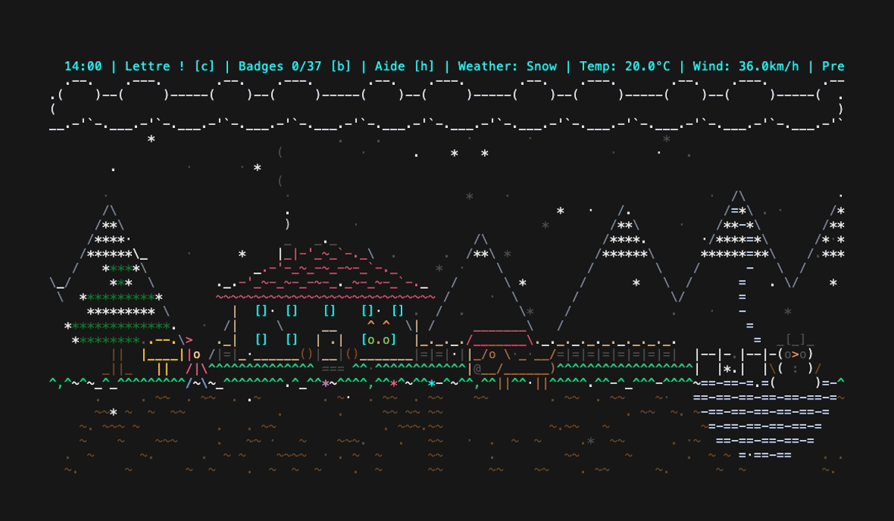
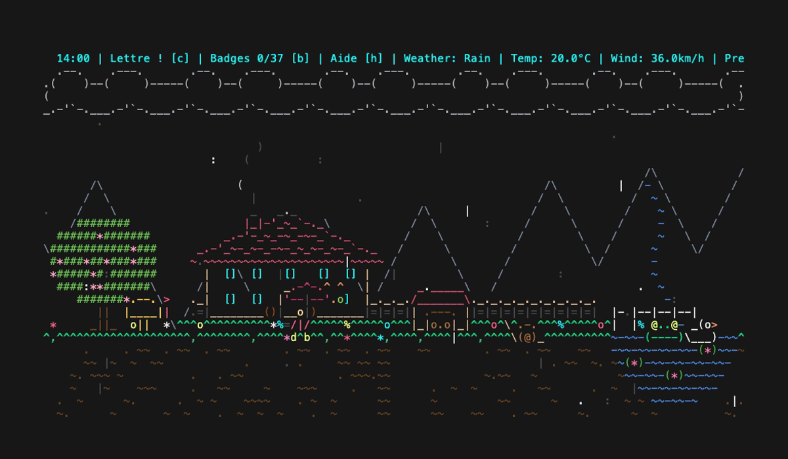
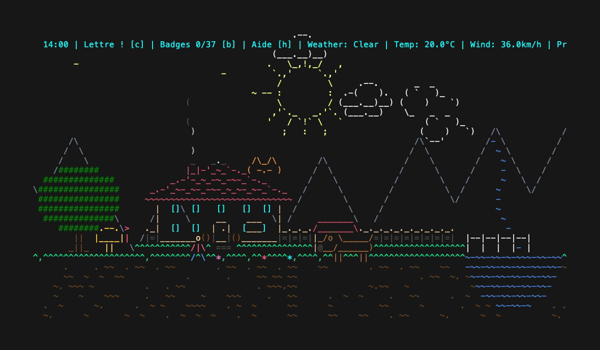

# weathr

Une météo animée en ASCII dans le terminal, avec un petit village qui vit au rythme des saisons, du vrai temps qu'il fait et du courrier de ses habitants.

Version personnalisée de [Veirt/weathr](https://github.com/Veirt/weathr) : la météo en temps réel vient toujours d'Open-Meteo, mais la scène s'enrichit d'un jardin, d'animaux, d'une histoire en lettres, de badges et d'une mise à jour proposée au lancement.

## Aperçu

|                              Hiver · neige                               |                             Printemps · pluie                              |                               Été · soleil                               |
| :----------------------------------------------------------------------: | :------------------------------------------------------------------------: | :----------------------------------------------------------------------: |
|  |  |  |

## Sommaire

- [Installation](#installation)
- [Mise à jour](#mise-à-jour)
- [Utilisation](#utilisation)
- [Le village](#le-village)
- [Configuration](#configuration)
- [Fichiers créés](#fichiers-créés)
- [Confidentialité](#confidentialité)
- [Licence](#licence)
- [Crédits](#crédits)

## Installation

Il faut [Rust](https://www.rust-lang.org/tools/install) et git. Le dépôt est privé : demander une invitation au préalable.

```bash
git clone git@github.com:srussier-luna/weathr.git ~/.weathr
cargo build --release --manifest-path ~/.weathr/Cargo.toml
cp ~/.weathr/target/release/weathr ~/.local/bin/weathr
```

Le dossier cloné doit rester en place : c'est lui que weathr met à jour.

## Mise à jour

- Au lancement, une fois par jour, weathr vérifie s'il y a des nouveautés sur le dépôt.
- S'il y en a, il liste jusqu'à 5 changements et demande `Mettre à jour maintenant ? [O/n]`.
- En acceptant, il récupère le code, recompile, remplace le binaire et redémarre.
- La vérification est ignorée avec `--silent`, sans terminal interactif, ou si le dossier source a des modifications locales.
- Mise à jour manuelle à tout moment :

```bash
weathr --update
```

## Utilisation

```bash
weathr
```

### Touches

| Touche          | Action                                    |
| :-------------- | :---------------------------------------- |
| `c`             | lire le courrier                          |
| `←` `→`         | parcourir les lettres ou les pages        |
| `1` `2`         | répondre à une question                   |
| `e`             | répondre à l'énigme de la gazette         |
| `r`             | ramasser un objet ou une bouteille        |
| `l`             | relire les lettres reçues (`↑` `↓` `Entrée`) |
| `a`             | album des souvenirs                       |
| `b`             | badges                                    |
| `h`             | aide                                      |
| `Échap`         | fermer la fenêtre                         |
| `q` / `Ctrl+C`  | quitter                                   |

### Options

```bash
# Simuler une météo
weathr --simulate rain
weathr --simulate snow --night

# Fêtes
weathr --christmas
weathr --fireworks

# Feuilles qui tombent et rafales
weathr --simulate clear --leaves

# Faire défiler toutes les scènes, 1 seconde chacune
weathr --demo
```

Météos disponibles :

- Ciel : `clear`, `partly-cloudy`, `cloudy`, `overcast`
- Pluie : `fog`, `drizzle`, `rain`, `freezing-rain`, `rain-showers`
- Neige : `snow`, `snow-grains`, `snow-showers`
- Orage : `thunderstorm`, `thunderstorm-hail`

Autres options :

```bash
weathr --imperial        # °F, mph, inch
weathr --metric          # °C, km/h, mm (par défaut)
weathr --auto-location   # position détectée via l'adresse IP
weathr --hide-location   # masquer la position
weathr --hide-hud        # masquer la barre d'état
weathr --silent          # pas de messages au démarrage
```

`NO_COLOR=1 weathr` désactive les couleurs.

## Le village

### Saisons et fêtes

- Les saisons suivent les dates astronomiques : printemps le 20 mars, été le 21 juin, automne le 22 septembre, hiver le 21 décembre.
- L'arbre fleurit au printemps, verdit l'été, se colore à l'automne et devient un sapin en hiver.
- Noël (24–25 décembre) : sapin et cadeaux.
- Nouvel An (± 7 jours) : bannière et feu d'artifice.
- Pâques (± 7 jours) : décorations dans le jardin.
- 14 juillet : feu d'artifice la nuit.
- Octobre : citrouilles et esprits d'Halloween.

### Scène et animaux

- Montagnes, rivière qui descend jusqu'à un étang, maison aux fenêtres qui s'éteignent le soir.
- Soleil qui suit la vraie course du jour, constellations de saison les nuits claires.
- Neige qui s'accumule, puis bonhomme de neige quand la couche est épaisse.
- Arc-en-ciel quand la pluie s'arrête en journée.
- Chat, chien et sa niche, écureuil, chouette la nuit.
- Canard, grenouille et escargot sous la pluie.
- Léo, l'enfant du village, qui saute dans les flaques.
- Le facteur passe à vélo à l'heure du courrier.

### Courrier

- Chaque jour, de nouvelles lettres arrivent à l'heure du courrier (9 h par défaut).
- Une centaine de lettres datées : habitants, voisins, archives et un voisin du n°13 un peu inquiétant.
- Certaines lettres posent une question : la réponse change la suite et la scène.
- Chaque lundi, une gazette avec rumeurs, annonces et une énigme.
- Une recette le 1er de chaque mois, une carte postale chaque semaine.
- Lire les lettres débloque des éléments dans le décor : banc, puits, cabane dans l'arbre, montgolfière…
- Plus tard, des objets apparaissent au sol et des bouteilles descendent la rivière, à ramasser avec `r`.

### Badges

- 37 badges en 5 familles : Météo, Fêtes, Rares, Fidélité, Secrets.
- Exemples : voir chaque type de vraie météo, ouvrir l'app entre minuit et 5 h, revenir 7 jours d'affilée.
- Les badges météo ne comptent pas en mode simulé.

### Alerte pluie

- Toutes les 10 minutes, weathr regarde les prévisions proches.
- Si la pluie arrive, la barre d'état affiche `Pluie vers HH:MM : prends ton parapluie !`.

## Configuration

Le fichier `config.toml` se trouve dans :

- **macOS** : `~/Library/Application Support/weathr/config.toml`
- **Linux** : `~/.config/weathr/config.toml` (ou `$XDG_CONFIG_HOME/weathr/config.toml`)
- **Windows** : `~/AppData/Roaming/weathr/config.toml`

Un `config.toml` dans le dossier courant est prioritaire.

```toml
# Masquer la barre d'état
hide_hud = false

# Pas de messages au démarrage (les erreurs restent affichées)
silent = false

[location]
# Coordonnées (ignorées si auto = true)
latitude = 48.8566
longitude = 2.3522

# Position détectée automatiquement (true par défaut si pas de config)
auto = false

# Masquer la position
hide = false

# Affichage : "coordinates" | "city" | "mixed"
display = "mixed"

# Nom de ville forcé, sans recherche
# city = "Paris"

# Langue du nom de ville ("auto" ou un code comme "fr", "en")
# city_name_language = "auto"

[units]
temperature = "celsius"     # "celsius" ou "fahrenheit"
wind_speed = "kmh"          # "kmh", "ms", "mph" ou "kn"
precipitation = "mm"        # "mm" ou "inch"

[courrier]
# Heure d'arrivée du courrier (0 à 23)
heure = 9
```

### Affichage de la position

| Mode          | Ville trouvée                        | Ville introuvable           |
| :------------ | :----------------------------------- | :-------------------------- |
| `coordinates` | `Location: 48.86°N, 2.35°E`          | `Location: 48.86°N, 2.35°E` |
| `city`        | `Location: Paris`                    | `Location: 48.86°N, 2.35°E` |
| `mixed`       | `Location: Paris (48.86°N, 2.35°E)`  | `Location: 48.86°N, 2.35°E` |

## Fichiers créés

Dans le même dossier que `config.toml` :

- `progress.json` : avancement (lettres lues, badges, réponses, objets trouvés, série de jours).
- `lettres.txt` : les 60 lettres du village, modifiables. Un en-tête `=== N | expéditeur` remplace la lettre N ou en ajoute une à partir de 61.
- `update_check` : date de la dernière vérification de mise à jour.

## Confidentialité

- Météo, alerte pluie et récapitulatif de la gazette : la position est envoyée à `api.open-meteo.com`.
- Cartes postales : seules les coordonnées de la ville de la carte sont envoyées à Open-Meteo.
- Nom de ville : recherche via Nominatim (OpenStreetMap).
- Position automatique : sur macOS, la commande locale `CoreLocationCLI` est essayée d'abord, puis `ipinfo.io` via l'adresse IP.
- Pour éviter tout appel de localisation, mettre `auto = false` et renseigner les coordonnées.
- Mise à jour : `git fetch` vers le dépôt d'origine du dossier cloné.

## Licence

GPL-3.0-or-later, comme le projet d'origine.

## Crédits

- Projet d'origine : [Veirt/weathr](https://github.com/Veirt/weathr).
- Données météo : [Open-Meteo.com](https://open-meteo.com/), licence [CC BY 4.0](https://creativecommons.org/licenses/by/4.0/).
- Géocodage : [Nominatim](https://nominatim.openstreetmap.org/), données © [contributeurs OpenStreetMap](https://www.openstreetmap.org/copyright), licence [ODbL](https://opendatacommons.org/licenses/odbl/).
- Art ASCII ([asciiart.eu](https://www.asciiart.eu/)) : maison et avion de Joan G. Stark, soleil de Hayley Jane Wakenshaw (Flump), lune de Joan G. Stark.

_Si un dessin ASCII n'est pas crédité ou mal attribué, il appartient à son auteur d'origine._
